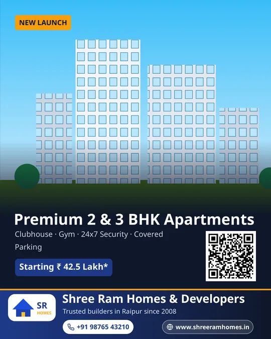

# Poster Engine

The core of a branded-creative SaaS (in the style of Brands.live). Small businesses get daily festival
posts, business flyers and reels with their logo, name, phone, website and brand colours already
applied, with no manual editing.

This folder contains:

| Path | What |
|---|---|
| [`docs/ARCHITECTURE.md`](docs/ARCHITECTURE.md) | System architecture, user journey mapped to services, render pipeline, multi-tenancy, capacity plan |
| [`docs/ROADMAP.md`](docs/ROADMAP.md) | Phased MVP plan: auth & business setup → rendering → daily generator → editor → video → integrations |
| [`docs/TEMPLATE_SPEC.md`](docs/TEMPLATE_SPEC.md) | Template and frame JSON specification (layers, bindings, frames, overrides) |
| [`schemas/template.schema.json`](schemas/template.schema.json) | The same specification as JSON Schema 2020-12 |
| [`db/schema.sql`](db/schema.sql) | PostgreSQL schema with row-level security: tenants, users, subscriptions, business profiles, templates, festival calendar, generated creatives, integrations |
| [`src/`](src) | Headless image composer (Node.js + sharp) and an HTTP render worker |
| [`templates/`](templates), [`frames/`](frames) | Sample templates and interchangeable footer frames |

| Diwali + wave footer | Same template + classic footer | Real-estate promo (4:5) |
|---|---|---|
|  |  |  |

All three use the same business profile. The first two are the same template with a different
frame.

## Quick start

```bash
cd poster-engine
npm install
npm run demo     # renders samples into ./out
npm test         # node:test suite
npm start        # render worker on :7070
```

Text is drawn with the fonts installed on the machine. Install **Noto Sans** and **Noto Sans
Devanagari** (Debian/Ubuntu: `apt install fonts-noto-core`) for the samples to look as shown above.
The `Dockerfile` builds a worker image with the fonts included.

## Using the composer

```js
const { renderTemplate, createAssetLoader, renderCacheKey } = require('./src');

const template = require('./templates/realestate-2bhk-promo.json');
const loadAsset = createAssetLoader({ assetRoot: './templates/assets', allowedHosts: ['cdn.example.com'] });
const loadFrame = async (id) => require(`./frames/${id}.json`);

const data = {
  business: { name: 'Shree Ram Homes', phone: '+91 98765 43210', website: 'shreeramhomes.in', city: 'Raipur' },
  brand: { logo: { primary: 'sample-logo.svg' }, colors: { primary: '#1e3a8a', accent: '#f59e0b' } },
  post: { headline: 'Ready-to-move 2 BHK', price: 'Starting ₹ 42.5 Lakh*' },
};

const options = {
  loadAsset,
  loadFrame,
  frameId: 'footer-classic',                           // the user's chosen frame
  overrides: { 'frame/website': { hidden: true } },    // edits saved by the canvas editor
  width: 1080,                                         // output size; the layout scales
  format: 'webp',
};

const { buffer, info, stats } = await renderTemplate(template, data, options);
const key = renderCacheKey(template, data, options);   // store as creatives/<key>.webp
```

How the composer works (`src/render/composer.js`):

1. **Validate** the template against the JSON Schema and check that layer ids are unique.
2. **Expand frames:** each `frame` placeholder is replaced by the selected frame document, as a group
   scaled into the slot box.
3. **Flatten** groups into absolute canvas coordinates, scaled to the output width, and apply the
   editor overrides (`frame/phone`, `headline`, …).
4. **Resolve bindings** (`{{ business.phone || business.whatsapp }}`) for each layer. Layers whose
   content is empty are skipped.
5. **Render every layer in parallel** to a transparent PNG at its exact bounding box:
   - `text`: Pango + HarfBuzz (correct Indic shaping), shrink-to-fit inside the box, alignment, shadow;
   - `logo`: trim empty borders, fit inside the box, optional background plate;
   - `badge`: icon + text pill sized to its content;
   - `image`: cover/contain with content-aware crop; `shape`: SVG rect/ellipse/path with gradients;
     `qr`: QR code.
6. Apply opacity and rotation, clip to the canvas, and **composite all layers in one sharp call**.
   Encode as PNG, WebP or JPEG.

One failing optional layer (for example an unreachable logo URL) is skipped and reported in
`stats.skipped`, so the rest of the poster still renders. Pass `strict: true` to throw instead.

## Render worker API

```
POST /v1/render
Authorization: Bearer $RENDER_TOKEN        (when RENDER_TOKEN is set)
{ "templateId": "festival-diwali-square", "frameId": "footer-classic",
  "data": { "business": { … }, "brand": { … } }, "overrides": { … },
  "width": 1080, "format": "png" }

→ 200 image/png
  X-Render-Key: <sha256 cache key>   X-Render-Ms: 212.4   X-Render-Skipped: frame/website
→ 422 { "error": "Invalid template: …", "details": [ … ] }
```

| Env | Default | |
|---|---|---|
| `PORT` | 7070 | |
| `RENDER_CONCURRENCY` | 4 | Renders in parallel; extra requests wait |
| `RENDER_TOKEN` | – | Required bearer token for every request except `/healthz` |
| `TEMPLATE_DIR`, `FRAME_DIR` | `./templates`, `./frames` | |
| `ASSET_ROOT` | `./templates/assets` | Local asset directory |
| `ASSET_HOSTS` | – | Comma-separated HTTPS hosts that assets may be loaded from |

The worker is internal. The main API handles authentication, tenancy, plan limits and caching (see
[ARCHITECTURE.md § 4](docs/ARCHITECTURE.md#4-render-pipeline)).
