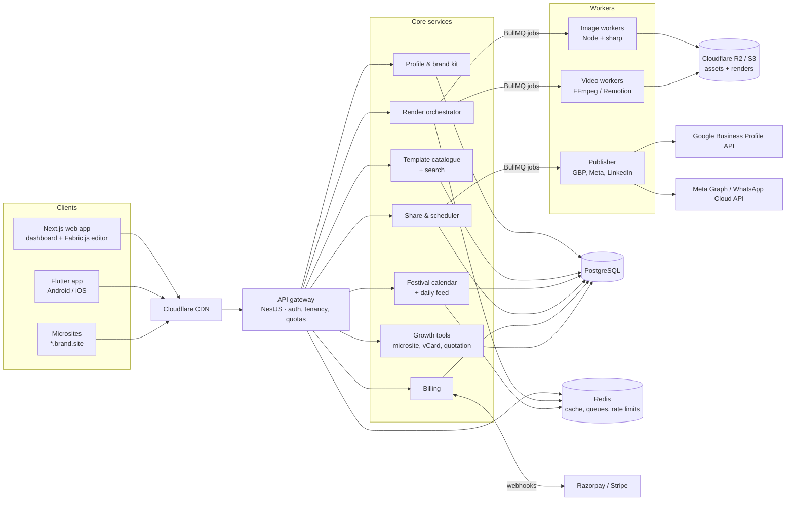
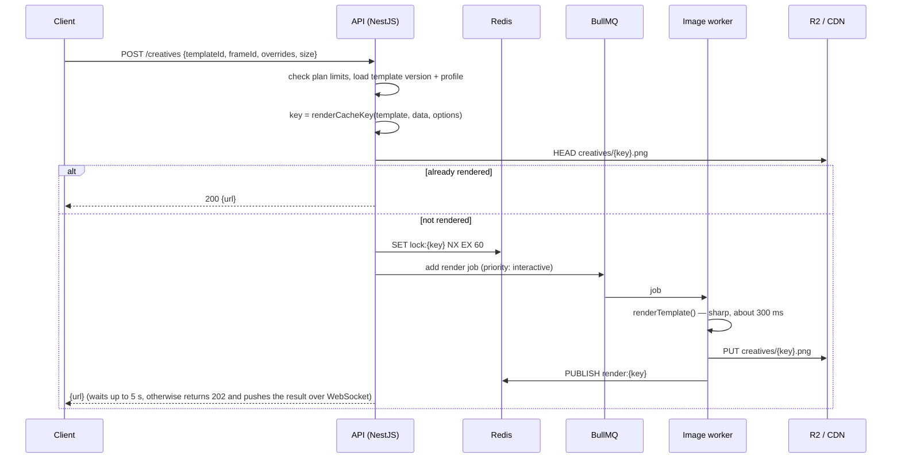

# Poster Engine: System Architecture

A multi-tenant SaaS that puts a business's branding (logo, name, phone, website, address, brand
colours) onto a large catalogue of festival posts, business flyers and reels, with no manual editing.
Clients are a Next.js web dashboard and a Flutter app for Android and iOS.

This document describes the target system. The code in this folder implements its core: the
template specification, the headless image composer and a render worker.

---

## 1. Design principles

1. **One template format everywhere.** The JSON spec in [`TEMPLATE_SPEC.md`](TEMPLATE_SPEC.md) is
   read by the server renderer (sharp), the web editor (Fabric.js) and the Flutter preview. A
   template designed once looks the same in every client and in the exported file.
2. **Templates are shared; branding is per tenant.** Template artwork is stored once. A user's
   branding is applied by binding `{{ business.* }}` and `{{ brand.* }}` at render time, and by the
   **frame**, a reusable footer or header that is placed into the template's frame slot.
3. **Render lazily, cache by content hash.** Nothing is rendered until someone views it at full size,
   downloads it or shares it. The output is stored under `sha256(template@version, data, frame,
   overrides, size)`, so the same request never renders twice.
4. **The feed is cheap.** The feed shows the unbranded template thumbnail (shared by all users, served
   from the CDN) with the user's frame on top as a transparent PNG. The frame overlay is rendered once
   per (business, frame, aspect ratio, profile revision). Scrolling 300 posts costs 0 server renders.
5. **Immutable template versions.** A published version is never changed, so any past creative can be
   re-rendered exactly (for a higher-resolution export or after a storage loss).

---

## 2. System context



Start as a **modular monolith**: one NestJS application with one module per box under "Core
services", plus separately deployed **workers**, because rendering is CPU-bound and scales on its own.
Split modules into services only when a team or a scaling need requires it.

| Component | Technology | Notes |
|---|---|---|
| Web app | Next.js (App Router), Tailwind, Fabric.js | Editor works on the template JSON; SSR for microsites and SEO |
| Mobile app | Flutter, Bloc | Feed, quick edit, share sheet, offline cache of the feed |
| API | NestJS (REST + WebSocket gateway) | JWT access token (15 min) + rotating refresh token; OTP login via SMS/WhatsApp |
| Image rendering | Node.js + sharp (libvips, Pango, HarfBuzz) | This repo. About 150–400 ms for a 1080 px post on one core |
| Video rendering | FFmpeg (overlay templates), Remotion (animated templates) | Separate queue and autoscaling group |
| Queue | BullMQ on Redis | Priority: interactive > prefetch > bulk; per-tenant concurrency limits |
| Database | PostgreSQL 15+ with row-level security | Schema in [`../db/schema.sql`](../db/schema.sql) |
| Cache | Redis | Daily feed per (date, language, industry), plan limits, rate limits, render locks |
| Storage | Cloudflare R2 (S3 API) + Cloudflare CDN | No egress fees; signed URLs for private assets |
| Payments | Razorpay (India, UPI autopay), Stripe (international) | Webhooks are idempotent through `payment_events` |
| Observability | OpenTelemetry → Grafana/Tempo, Sentry | Render latency, queue depth and cache hit rate are key metrics |

---

## 3. User journey mapped to services

### A. Onboarding and "My Business"

1. Sign up with a phone OTP or Google. A `tenant` (kind `business`) and an `owner` membership are created.
2. Choose an industry and sub-categories (`categories` tree). These drive the feed.
3. Enter the business name, phone, WhatsApp, email, website, address and social handles
   (`business_profiles`).
4. Upload logos (`brand_assets`). On upload the profile service:
   - checks the type and size, strips EXIF data and computes a hash to avoid duplicates;
   - creates **light and dark variants** when only one logo is given: a white version for dark
     artwork (threshold, then tint) and the original for light artwork;
   - extracts the dominant colours and suggests them as `brand_colors`.
5. Pick a default frame. The frame gallery is rendered live with the user's data (same engine, small
   output size).

Every profile change increments `business_profiles.revision`. The revision is part of each render
cache key, so stale branded images are never served.

### B. "Create Your Today's Post" (filter-driven generation)

The three dropdowns map directly to indexed columns of `templates`:

| Filter | Column | Index |
|---|---|---|
| Language | `languages text[]` | GIN |
| Content style | `content_style` | B-tree (in `templates_feed_idx`) |
| Niche / category | `categories text[]` (dotted ids such as `real-estate.2bhk`) | GIN |

The results are ordered by: exact category match, then `sort_weight` (editorial), then a popularity
score (`use_count`, decayed over time), then newest. Pages use keyset pagination. Popular filter
combinations are cached in Redis for 10 minutes.

**Automated frame blending** is the core of the product:

```
template.layers = [ background image, artwork text, …, { type: "frame", slot: "footer", box } ]
frame.layers    = [ bar, logo, name, phone badge, website badge ]      (in the frame's own design size)
render          = template layers, with the frame placeholder replaced by the frame's layers
                  scaled into the slot box, and every {{ binding }} resolved from the profile
```

**Custom canvas editor (Fabric.js / Flutter):** the editor loads the same template JSON and creates
one canvas object per layer. Only properties listed in a layer's `editable` array can be changed.
The editor never uploads a flattened image. It saves a small **override map**:

```json
{ "headline": { "text": "Ready to move in!" }, "frame/phone": { "hidden": true },
  "logo": { "box": { "x": 40, "y": 40, "w": 180, "h": 120 } } }
```

The server re-renders at full resolution with those overrides. The export is therefore always sharp,
fonts are always correct, and the edit can be re-applied later at any size.

### C. Festival and event calendar

- `festivals` holds the concept (names and greetings in every language, regions, importance).
  `festival_occurrences` holds the actual dates for each year. Most Indian festivals follow the lunar
  calendar, so their dates are loaded every year from a verified panchang source and reviewed by
  staff (`verified`). Fixed-date events (Independence Day, Teachers' Day) are generated from
  `fixed_date`.
- A **nightly job** (00:05 IST) builds the feed for the next 15 days for every
  (language, industry) pair and stores it in Redis: `feed:{date}:{lang}:{industry}` holds an ordered
  list of template ids grouped into Today, Tomorrow and Upcoming. Each user's feed is that list plus
  their frame overlay, so it needs no rendering and no database query.
- **Pre-warming:** at 05:00 local time, workers render today's top 3 posts at full size for active
  Pro users (`last_login_at` in the last 7 days) at low queue priority. The morning "share" tap is
  then instant.
- **Notifications:** an FCM push at 07:30 local time ("Your Diwali posts are ready") opens the app
  directly on today's feed.

Sample query used by the feed builder (checked against the schema):

```sql
SELECT f.key, o.date,
       array_agg(t.id ORDER BY (t.categories && ARRAY[$industry]) DESC, t.sort_weight DESC) AS templates
FROM festival_occurrences o
JOIN festivals f ON f.key = o.festival_key
JOIN templates t ON t.festival_keys @> ARRAY[f.key] AND t.status = 'published' AND t.kind = 'template'
WHERE o.date BETWEEN $today AND $today + 14
  AND o.region = ANY($regions)
  AND t.languages && ARRAY[$lang]
  AND t.categories && ARRAY['all', $industry]
GROUP BY f.key, o.date
ORDER BY o.date;
```

### One-click sharing

| Channel | Mechanism |
|---|---|
| WhatsApp, WhatsApp Status, Instagram (mobile) | Native share sheet with the image file (Flutter `share_plus`); Instagram Stories through its share intent |
| WhatsApp (web) | `https://wa.me/?text=` with a short link to a public creative page that has Open Graph image tags |
| Facebook Page, Instagram Business | Meta Graph API (`/{page-id}/photos`, `/{ig-user-id}/media` + `media_publish`) after OAuth |
| LinkedIn | Posts API with an image upload, after OAuth |
| Google Business Profile | `localPosts.create` on the connected location |

Every share is logged in `share_events`. These logs feed analytics and the popularity score.

### D. Short-form video and reels

There are two kinds of video templates, both described by `template_versions.video_spec`.

1. **Overlay reels (most of the catalogue, cheap).** A pre-rendered MP4 is combined with the user's
   branding, which is rendered as a transparent PNG by this image engine using the same frame.
   One FFmpeg pass with no re-encoding of the audio:

   ```bash
   ffmpeg -i base_reel.mp4 -i frame_overlay.png \
     -filter_complex "[0:v][1:v]overlay=0:H-h:enable='between(t,0.5,30)'" \
     -c:v libx264 -preset veryfast -crf 21 -c:a copy -movflags +faststart out.mp4
   ```

   It takes about 2–4 s for a 15 s 1080×1920 reel on 2 vCPUs.
2. **Animated reels (property showcases, price reveals).** Remotion compositions take
   `{ business, brand, post: { photos[], price, features[] } }` as input props. They render on Remotion
   Lambda or on a container fleet. Audio tracks come from a licensed library stored in `brand_assets`
   (kind `audio`) with beat markers, so photo transitions follow the music.

Video jobs run on their own BullMQ queue with per-plan monthly quotas (`usage_daily`). The client
receives progress over WebSocket (`render:{creativeId}` → `{ progress, status, url }`).

### E. Growth utilities

| Tool | Implementation |
|---|---|
| Microsite builder | `microsites.sections` JSON rendered by Next.js at `slug.brand.site` or a custom domain (Cloudflare for SaaS hostnames + TLS). The inquiry form writes to `leads` and sends a WhatsApp/email alert. |
| Google Business Profile | OAuth 2.0 with the `business.manage` scope. Scheduled posts go through `scheduled_posts` → publisher worker. Reviews and performance metrics (Business Profile Performance API) are synced nightly. |
| Quotation / invoice maker | `billing_documents` + PDF rendering. The business letterhead header and footer are frames rendered by this engine, so they match the posts. |
| Digital business card | vCard 3.0 file plus a QR code (`qr` layer type) and a public card page that records a lead on "save contact". |
| WhatsApp stickers | 512×512 WebP, under 100 KB, transparent, 3–30 per pack. Rendered by this engine with `format: "webp"` and packaged for the WhatsApp sticker-pack intent in the app. |
| Content library | `generated_creatives` (history, re-download, re-edit with the stored overrides) and `brand_assets` (uploads). |

---

## 4. Render pipeline



- **Deduplication:** the content-hash key together with the Redis `NX` lock means that 1,000 users
  opening the same Diwali post at 07:30 result in one render per distinct profile, not 1,000 renders.
- **Watermark (free plan):** the API passes `watermark: { text }` to `renderTemplate()`, which draws a
  diagonal watermark above all layers. The watermark is part of the cache key, so a watermarked render
  is never served to a Pro user.
- **Worker sizing:** sharp uses the libuv thread pool. Run one worker process per 2 vCPUs with
  `RENDER_CONCURRENCY=4` and `UV_THREADPOOL_SIZE=8`. Scale workers on queue depth (KEDA or ECS
  target tracking). One 4-vCPU node renders about 15–25 posts per second at 1080 px.
- **Fonts are deployment artefacts.** They are installed in the worker image (see `Dockerfile`), and
  the same files are served to the web editor. A template lists its families in `fonts`, and CI
  rejects a template that uses a font not installed in the image.
- **Asset access:** workers read assets from R2 by key. URLs supplied by users are fetched only from
  an allow-list of hosts (SSRF protection), with size and time limits (`src/render/assets.js`).

---

## 5. Multi-tenancy and security

- Every tenant-owned table has `tenant_id`. PostgreSQL **row-level security** applies
  `tenant_id = current_setting('app.tenant_id')`. The API sets it with `SET LOCAL` at the start of
  each transaction. A missing setting fails the query, so a forgotten filter cannot leak data.
- Agencies are tenants of kind `agency`. Their client businesses are child tenants (`parent_id`). An
  agency user has memberships in each child tenant, and switching business switches `app.tenant_id`.
- OAuth tokens (Google, Meta, LinkedIn) are stored encrypted with KMS envelope encryption in
  `integration_accounts.token_ciphertext`. They are never sent to clients.
- Uploads: type check from the file's magic bytes, size limits, an image re-encode step that removes
  embedded payloads, and private R2 keys that are read through signed URLs.
- Rate limits are kept in Redis per user and per tenant. Render endpoints also have a per-plan daily
  quota (`usage_daily`).
- The render worker is internal only, and is reached with a service token (`RENDER_TOKEN`).

---

## 6. Capacity planning (first year)

| Assumption | Value |
|---|---|
| Daily active businesses | 100,000 |
| Full-size renders per active business per day | 3 (download or share) |
| Distinct renders after deduplication | about 300,000 per day; peak around 40 per second (07:00–10:00 IST) |
| Worker capacity | about 20 renders per second per 4-vCPU node, so 2–3 nodes at peak plus headroom |
| Storage | 300,000 × about 250 KB ≈ 75 GB per day. Delete renders not accessed in 30 days with an R2 lifecycle rule; they can always be re-rendered from the stored inputs. |
| Feed thumbnails | Served from the CDN; their cost is independent of the number of users |
